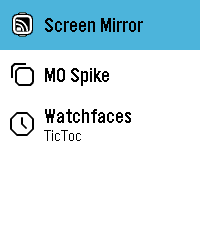
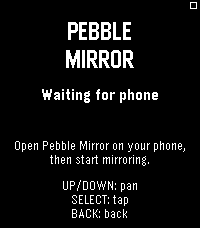
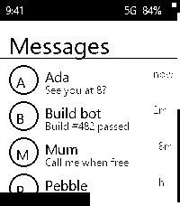
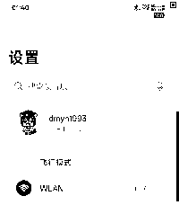
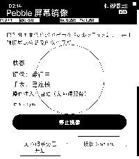

# Pebble 屏幕镜像 / Pebble Screen Mirror

[](https://github.com/dmyn1993/pebble-screen-mirror/actions/workflows/build.yml)
[](https://github.com/dmyn1993/pebble-screen-mirror/releases/latest)

把 Android 手机屏幕以 **200×228 黑白画面**镜像到 Pebble Time 2（emery），并用
手表的触摸屏 / 按键反向操作手机。手机端支持三种注入方式：

1. **无障碍服务**（推荐，无需 root）
2. **Shizuku**（shell 权限；Shevery 等兼容实现也可）
3. **Root**（`su`）

> **直接下载**：最新 APK / PBW 在
> [Releases](https://github.com/dmyn1993/pebble-screen-mirror/releases/latest)。
> 无需自己构建；源码构建见第 3–5 节。

> 受 Pebble 蓝牙 AppMessage 带宽限制，实际刷新率通常为 **1–3 帧/秒**。它适合阅读
> 通知、聊天、网页和做简单点击/滑动，不适合视频或游戏。

---

## 1. 架构

```
┌──────────────────────────────┐
│ Pebble Time 2 (emery)        │
│  Screen Mirror watchapp (C)  │
│  · 1-bit GBitmap 200×228     │
│  · touch_service 原始触摸     │
│  · 上/下键平移、Select 点击   │
└──────────────┬───────────────┘
               │ AppMessage（8K，二进制 tile）
┌──────────────▼───────────────┐
│ 官方 Pebble 手机应用          │
│ coredevices.coreapp          │
│ PebbleKit Classic 广播桥      │
│  · SEND / RECEIVE             │
│  · ACK / NACK                 │
└──────────────┬───────────────┘
               │ Android 广播（本机）
┌──────────────▼───────────────┐
│ Pebble 屏幕镜像（本项目 APK）  │
│  · MediaProjection 采集       │
│  · 缩放 / 抖动 / 8×8 tile     │
│  · 帧差分、关键帧、背压        │
│  · 触摸→手机坐标映射           │
│  · 无障碍 / Shizuku / Root 注入│
└──────────────────────────────┘
```

**为什么用 PebbleKit Classic 广播，而不是 PebbleKit2？**

官方手机应用（`coredevices/mobileapp`）里的 `PebbleKitClassic` 同时实现了
“手表 → 伴侣应用”和“伴侣应用 → 手表”两个方向；而当前 `PebbleKit2` 的
`BasePebbleSenderReceiver`（伴侣应用 → 手表）在官方应用中还没有对应的具体服务。
因此本项目让 watchapp **不携带 PKJS、也不声明 `companionApp`**，官方应用就会走
`PebbleKitClassic` 路径，双向通信都可以工作。详见
[`docs/ARCHITECTURE.md`](docs/ARCHITECTURE.md)。

---

## 2. 目录

```
pebble-screen-mirror/
├── .github/workflows/        # CI 构建 + tag 自动发布
├── watchapp/                 # Pebble C watchapp + package.json + wscript
│   ├── art/menu_icon.svg
│   ├── resources/images/menu_icon.png
│   ├── src/c/main.c
│   ├── package.json
│   └── wscript
├── android-app/              # Android Studio / Gradle 工程（纯 Java）
│   └── app/src/main/java/com/pebblemirror/companion/
├── docs/
│   ├── images/               # README 截图
│   ├── ARCHITECTURE.md
│   └── PROTOCOL.md
├── scripts/
│   ├── build-android.ps1
│   └── build-watchapp.sh
├── tools/
│   ├── generate_test_frame.py
│   └── send_test_frame.py
└── dist/README.md            # Release 产物说明（二进制不提交）
```

上游参考仓库：

- [coredevices/PebbleOS](https://github.com/coredevices/PebbleOS) — 触摸服务、
  `GBitmap` 1-bit 行对齐/位序、AppMessage 上限等。
- [coredevices/mobileapp](https://github.com/coredevices/mobileapp) —
  `PebbleKitClassic` 的广播协议、appinfo 解析、权限行为。
- [coredevices/pebble-watchface-agent-skill](https://github.com/coredevices/pebble-watchface-agent-skill)
  — `pebble build` / 模拟器 / 截图验证流程。

这些上游仓库**不包含在本仓库中**，开发时按需 clone 到 `third_party/` 阅读参考；
它们各自的许可证见对应上游。

---

## 3. 环境要求

### 手表端

- Pebble SDK **4.33.1**、`pebble` tool **5.0.40**。
- Windows 上建议在 **WSL Ubuntu** 中安装 Pebble SDK（官方 SDK 安装器在 Windows
  原生环境下会在创建 venv 时使用 `bin/python` 而失败）。
- 目标平台：`emery`（Pebble Time 2）。代码使用动态尺寸，理论上可扩展到 flint，
  但当前只构建/验证了 emery。

### 手机端

- Android **8.0+**（minSdk 26），建议 Android 13+。
- 官方 Pebble 手机应用 **`coredevices.coreapp`**，并保持手表已配对。
- 官方应用中的 **Legacy PebbleKit** 默认开启；如果关闭，请在 Pebble 应用设置里
  打开 “Legacy PebbleKit”。
- 构建：JDK 17、Android SDK Platform 36、Gradle 8.11.1。

### 权限

- 录屏：MediaProjection（每次开始镜像时系统弹窗确认）。
- 通知：Android 13+ 前台服务通知。
- 操作注入（三选一）：
  - 无障碍服务：系统设置 → 无障碍 → Pebble 屏幕镜像。
  - Shizuku：安装并启动 Shizuku，授予本应用权限。
  - Root：Magisk / KernelSU 等提供 `su`。
- **LSPosed 不需要**；本项目没有使用 Xposed hook。若以后要做更底层的注入，可以再接入。

---

## 4. 构建

### 4.1 构建 watchapp

在 WSL 中：

```bash
cd watchapp
/opt/pebble-venv/bin/pebble build
# 产物：build/watchapp.pbw
```

如果 `pebble` 已在 PATH：

```bash
pebble build
```

模拟器验证：

```bash
pebble install --emulator emery --vnc
pebble screenshot --emulator emery --vnc --no-open screenshot.png
```

> `--vnc` 让 QEMU 无本地窗口运行；`pebble screenshot` 仍然可以抓到手表画面。

### 4.2 构建 Android APK

```powershell
cd android-app
.\gradlew.bat :app:assembleDebug
# 产物：app/build/outputs/apk/debug/app-debug.apk
```

如果 Gradle 下载依赖需要代理，在 `android-app/gradle.properties` 里加：

```properties
systemProp.http.proxyHost=127.0.0.1
systemProp.http.proxyPort=7892
systemProp.https.proxyHost=127.0.0.1
systemProp.https.proxyPort=7892
```

或者先手动下载 Gradle 8.11.1 并解压，用解压后的 `gradle.bat` 构建。

### 4.3 一键脚本

```powershell
# 只构建 APK
.\scripts\build-android.ps1
```

```bash
# WSL 中构建 watchapp
./scripts/build-watchapp.sh
```

---

## 5. 安装与使用

### 5.1 直接下载（推荐）

从 [最新 Release](https://github.com/dmyn1993/pebble-screen-mirror/releases/latest)
下载：

- `PebbleMirror-vX.Y.Z-debug.apk`（debug 签名，可直接 `adb install`）
- `ScreenMirror-vX.Y.Z.pbw`

```powershell
adb install -r PebbleMirror-vX.Y.Z-debug.apk
```

```bash
pebble install --adb <设备序列号> ScreenMirror-vX.Y.Z.pbw
```

### 5.2 从源码构建后安装

1. 安装 APK：
   ```powershell
   adb install -r android-app\app\build\outputs\apk\debug\app-debug.apk
   ```
2. 安装 watchapp：
   ```bash
   # 手机已用 USB 连接、并已开启 adb 调试时最方便：
   pebble install --adb <设备序列号>

   # 或走局域网
   pebble install --phone <手机局域网 IP>
   # 或
   pebble install --cloudpebble
   ```
   也可以把 `watchapp/build/watchapp.pbw` 通过官方 Pebble 应用的开发者入口安装。
3. 在手表上打开 **Screen Mirror**。它会显示 “Waiting for phone”。
4. 打开手机上的 **Pebble 屏幕镜像**：
   - 建议先点“开启无障碍手势”，在系统设置中启用；
   - 或点“授权 Shizuku”；
   - 或把“操作注入方式”切到 Root，在 Magisk/KernelSU 弹窗中授权。
5. 点 **开始镜像**，允许系统录屏。Android 14+ 已请求“整个屏幕”；如果 OEM
   弹窗仍显示“单个应用”，请手动改成“整个屏幕”，否则只能镜像选中的应用。
   应用会同时向官方 Pebble 应用发送
   `com.getpebble.action.app.START`，尝试自动打开手表上的 Screen Mirror；
   如果自动打开失败，可点“在手表上打开 Screen Mirror”重试。
6. 手表上出现手机画面后即可操作。开始镜像时手机前台是本应用，先按手机 Home
   或切换到你想操作的应用，再在手表上操作：
   - **触摸屏**：点按、滑动、画圈/S 形（完整轨迹在松手后回放；长按单独注入）。
   - **上 / 下键**：平移视口（竖屏模式）。
   - **Select**：点击画面中心。
   - **双击 Select**：最近任务。
   - **长按 Select**：主页。
   - **返回键**：Android 返回。
   - **长按返回键**：退出 watchapp（系统行为）。
7. 手机端可设置：
   - 取景：竖屏视口 / 整屏缩放（留黑边）
   - 黑白：直接阈值 / Atkinson 抖动
   - 刷新率上限：1 / 2 / 3 / 5 fps
   - 注入方式：自动 / 无障碍 / Shizuku / Root

### 首次使用建议

- 先开启无障碍服务，这是最稳定、延迟最低的方式。
- 在竖屏视口模式下，手机屏幕宽度会完整缩放到 200px，文字仍然可读；用上/下键
  平移查看长页面。
- 如果只看整屏概览，切换到“整屏缩放”。

---

## 6. 传输与性能

- 画面：1-bit、200×228，LSB-first 位序；8×8 tile，每 tile 8 字节。
- 手机端只发送变化的 tile；变化超过 60% 或切换视口/模式时发送关键帧。
- 关键帧 725 个 tile ≈ 7.25KB；8K 手机直接一条 AppMessage 发完，小 inbox 才分块。
- `PebbleKitClassic` 的每条消息都要等手表 ACK；典型 1–3 帧/秒。
- 首次连接/切换视口会有 1–2 秒的整帧传输。
- 手表端有 5.8KB staging + 5.8KB display 两块 1-bit 位图，内存占用约 12KB；
  emery 可用 128KB，余量充足。
- 触摸轨迹不逐点实时发送：手表在本地记录折线，松手时用一条 `PATH`
  消息发送（最多 256 点、约 1KB），避免每个 MOVE 都占一条 AppMessage。
  回放形状与手表轨迹一致，但注入时机是松手后，不是实时指针。
- 手机端用 480px 宽的虚拟显示采集，再缩放到手表尺寸，降低 CPU/GPU 负担。

---

## 7. 故障排查

### 手表一直显示 “Waiting for phone”

- 手机端是否点了“开始镜像”？
- 官方 Pebble 应用是否在后台且手表已连接？
- 官方应用设置中 **Legacy PebbleKit** 是否开启？
- 官方应用如果开启了实验性插件，可能需要在应用页允许 Screen Mirror 的
  `LegacyPebbleKit` 权限。
- 看 Android 日志：
  ```powershell
  adb logcat -s PebbleMirrorLegacy PebbleMirrorController PebbleMirrorCapture
  ```
- 看手表日志：
  ```bash
  pebble logs --emulator emery
  # 真机：pebble logs --phone <ip>
  ```

### 轨迹回放速度不对

已修复：之前把 Pebble `time_ms()` 返回的“当前秒内 0..999ms”当成单调毫秒，
跨秒时会算出巨大时长，快速画圈也会回放得很慢。现在用
`time() * 1000 + time_ms()` 合成单调毫秒；回放时长就是手表上真实的按下/抬起
时长，快画快放、慢画慢放。

Shizuku（含 Shevery）和 Root 模式原先还有一个独立问题：路径是逐点调用
`input motionevent`，每个点要启动一个 `app_process`（约 20ms），所以即使
duration 正确，整条轨迹仍会被拉长。现在改用 `PathInjectorMain`：通过一个
`app_process` 进程调用 `InputManagerGlobal.injectInputEvent`，按真实时间
间隔一次注入所有点。实测 32 点、1200ms 的合成路径：`path-ok`，命令总耗时
1480ms（其中约 280ms 是 JVM 启动，轨迹本身 1200ms）。只有 helper 不可用时
才回退到点数较少的 `input motionevent`。

### 快速点按被识别成长按

已修复：手表端用本地按下/抬起时长判断，**<=480ms 且位移小于 8 像素**直接发
`TOUCH_TAP`；更长且不动发 `TOUCH_LONG`；只有明显拖动才发 `PATH` 路径消息。
手机端优先使用触摸消息里的 `DURATION`，不再用两条消息的到达时间差。
重新安装 APK 和 PBW 后再试。

### 有画面但点按没反应

- 手机端状态卡里“操作注入”显示什么？
  - “自动（不可用…）”：开启无障碍，或授权 Shizuku / Root。
  - “无障碍（未开启）”：到系统设置里启用本应用的无障碍服务。
  - “Shizuku（未授权）”：点“授权 Shizuku”，在 Shizuku 弹窗里允许。
- 某些安全窗口（银行、DRM 视频）会阻止 MediaProjection 或注入，这是系统限制。

### 录屏弹窗只有“单个应用”

Android 14+ 代码已请求整个屏幕；如果某些 OEM 弹窗仍默认“单个应用”，点开
下拉框改成 **整个屏幕**，否则只会镜像选中的应用，切到别的应用就黑屏/停住。

### 手表上画面太黑 / 文字糊

- 在“黑白处理”里选 **直接阈值**（默认），它比 Atkinson 更适合文字和 UI。
- 手机使用深色模式时，深色背景会被压成黑色；这是 1-bit 屏幕的固有限制，
  可切到浅色主题或使用“直接阈值”。
- 200px 宽的物理限制决定了小字不可能完全清楚；竖屏视口 + 上/下键平移看局部。

### Root 模式不可用

- Magisk / KernelSU / SukiSU 需要在管理器里给本应用授权，并确保 `su` 对应用
  可见（有的版本叫 “su 兼容模式” / “Mount namespace”）。
- 如果 `adb shell` 里都找不到 `su`，本应用的 Root 模式也不会可用；请直接用
  无障碍服务或安装 Shizuku。当前测试机（OnePlus + SukiSU）就是这种情况。

### 锁屏后镜像自己停了

Android 的隐私策略会在锁屏/灭屏时停止 MediaProjection（一加/ColorOS 上已验证）。
保持手机解锁和常亮，或临时打开开发者选项里的“充电时屏幕不休眠”。
重新点“开始镜像”并再次授权即可；锁屏前的最后一帧会留在手表上，不会自动恢复。

### 画面很卡 / 更新很慢

- 把刷新率上限调到 1 或 2 fps。
- 用“直接阈值”而不是 Atkinson，编码更快、文字更清晰。
- 避免播放视频；这是蓝牙 AppMessage 的物理限制。
- 视口模式下每次平移都会触发关键帧；连续快速按上/下键会排队，稍等即可。

### 构建 watchapp 报 `FileNotFoundError: .../venv/bin/python`

这是 Windows 原生 SDK 安装器的已知问题。请在 WSL 中安装/运行 Pebble SDK。

### Android 构建下载慢

设置 Gradle 代理（见 4.2），或预下载 Gradle 8.11.1 和依赖。首次构建需要下载
AGP、AndroidX、Material、Shizuku 等依赖。

---

## 8. 安全与隐私

- 屏幕画面只在手机本地处理，通过蓝牙发给已配对的手表，不经过网络。
- 手机端不申请 `INTERNET` 权限（当前代码不需要联网）。
- Legacy PebbleKit 广播是本机隐式广播，理论上其他应用可以伪造 `RECEIVE` 广播
  注入触摸；这是旧 PebbleKit 协议本身的限制。请只安装可信应用。
- 无障碍服务只执行手势/全局操作，不读取窗口内容。
- Shizuku / Root 会给予本应用 shell 级注入能力；不使用时请选择“无障碍”模式或
  撤销授权。
- 录屏内容可能包含密码、验证码等敏感信息，镜像时请注意周围环境。

---

## 9. 已验证 / 未验证

已在开发机上完成：

- watchapp 使用 Pebble SDK 4.33.1 构建成功；
- 在 QEMU `emery` 模拟器中安装、截图，验证启动页、整帧显示、tile 差分、
  配置/滚动条、按键平移；
- Android 工程使用 Gradle 8.11.1 / AGP 8.9.1 / JDK 17 构建成功，
  产物 `android-app/app/build/outputs/apk/debug/app-debug.apk`；
- Android 单元测试 20 项全部通过（帧编码/位序、视口映射、触摸分类、
  Legacy JSON 编解码），`:app:lintDebug` 通过。

已在真实设备上完成端到端联调：

- 手机：OnePlus PKX110，Android 16（SDK 36），1080×2344；
- 手表：Pebble Time 2（emery）；
- 官方 Pebble 应用 `coredevices.coreapp` 1.15.0.1；
- 通过 `pebble install --adb <serial>` 把 PBW 安装到真实手表；
- 手机端 `START` 广播成功拉起 watchapp；
- 手表 `HELLO` → 手机 `CONFIG/STATUS` → 手表 `REQUEST` 的会话建立成功；
- 真实手表上能持续显示手机画面（主屏、应用界面、第三方应用），
  AppMessage 8K/7250 字节整帧被手表 ACK；
- 手机端无障碍注入已验证：通过 shell 合成一个手表 `TOUCH` 命令，坐标从
  watch(55,55) 映射到 phone(297,297)，`dispatchGesture` 完成并打开手机搜索页；
- 路径回放已验证：合成一条 32 点 `PATH` 消息，手机端日志
  `watch path 32 points, 1200ms`、`dispatchPath 32 points`，无障碍手势完成；
- Shizuku（Shevery）路径也已用同一 32 点/1200ms 合成消息验证：
  `PathInjectorMain` 通过 `app_process` 单进程注入，返回 `path-ok`，
  命令总耗时 1480ms（含约 280ms 的 JVM 启动），轨迹本身按 1200ms 播放。
  Root 模式复用同一个 helper；helper 不可用时才回退到 `input motionevent`。

尚未自动化验证：

- 手表 **物理触摸屏/按键** 的实际手感、画圈/S 形路径（发送代码已通，
  但需要人在手表上画；手机端路径注入已用合成消息验证）；
- Shizuku（Shevery）已验证：32 点/1200ms 合成路径经 `app_process` helper
  返回 `path-ok`，命令总耗时 1480ms；Root 模式复用同一个 helper，路径注入
  逻辑相同，但这台机器的 `adb shell` 里没有 `su`，Root 分支未单独自动化验证。
  SukiSU/KernelSU 用户需要在管理器里授权本应用。
- 长时间稳定性、不同厂商 ROM 的后台限制；建议首次使用时观察 5–10 分钟。
- 个别 OEM 桌面页（尤其带 3D/玻璃图标的页面）可能被厂商当成安全图层，
  MediaProjection 只能抓到黑块；设置、普通应用和应用抽屉正常。实际使用前
  先打开目标应用即可，这不影响应用内镜像。

---

## 10. 屏幕截图

应用菜单图标（QEMU emery，25×25）：



图标源文件是 `watchapp/art/menu_icon.svg`，用 `rsvg-convert -w 25 -h 25`
生成 `watchapp/resources/images/menu_icon.png`，并在 `package.json` 中以
`menuIcon: true` 注册。

启动页（QEMU emery）：



合成测试画面（200×228，1-bit，验证 tile/位序/滚动条）：



真机画面（OnePlus PKX110 → Pebble Time 2，直接阈值模式）：



路径回放验证（合成 32 点圆，手机录屏里可见系统记录的轨迹）：



---

## 11. 自动构建与发布

仓库包含两个 GitHub Actions：

- `.github/workflows/build.yml`：push 到 `main` / PR / 手动触发时，
  构建 watchapp PBW 和 Android debug APK，运行 20 项单测与 lint，上传 artifacts；
- `.github/workflows/release.yml`：推送 `v*` tag 时，重新按 tag 版本构建，
  自动创建 GitHub Release，并附上 APK、PBW 和 `SHA256SUMS.txt`。

发布一个新版本：

```bash
git tag v1.0.0
git push origin v1.0.0
```

版本号会自动传入：

- watchapp 的 `package.json` 版本；
- Android 的 `versionName`（`versionCode` 使用 Actions run number）。

Release 中的 APK 是 **debug 签名**，可直接安装侧载；CI 使用
`android-app/ci/debug.keystore` 这个共享调试 key，保证后续版本可以覆盖安装。
如果之前装的是别的 debug key 签名的 APK，首次切换需要卸载一次。正式发布请
配置自己的 release keystore， **不要**把生产 key 提交到仓库。构建产物同时保留
为 Actions artifacts。

## 12. 许可证

本项目代码由本次会话生成，采用 MIT 许可证（见 `LICENSE`）。上游参考仓库
（PebbleOS、mobileapp、pebble-watchface-agent-skill）不在本仓库中分发，
遵循各自许可证。
